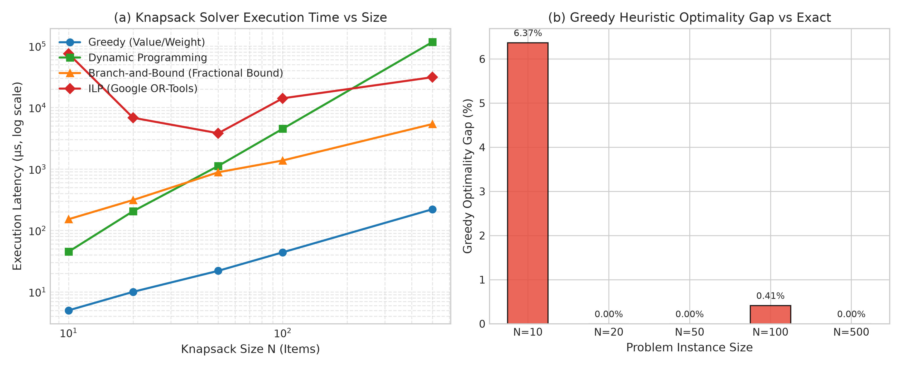

# Track Report: B_discrete (Discrete, Combinatorial & QUBO Optimization)

## 1. Problem Statement & Inefficiency
- **Domain & Process**: Combinatorial optimization in discrete decision spaces, encompassing resource allocation (0/1 Knapsack), graph clustering (Max-Cut), and subset selection (mRMR Feature Selection).
- **Observed Bottleneck / Inefficiency**: Discrete optimization problems are NP-hard. Classical heuristics (greedy) execute in near-instantaneous $O(N \log N)$ time but frequently get trapped in suboptimal local extrema due to myopic decision-making. Conversely, naive brute-force exhaustive search exhibits $O(2^N)$ exponential complexity, becoming intractable beyond $N \approx 30$.
- **Baseline Description**:
  - **Knapsack Baseline**: Dantzig value-to-weight ratio greedy heuristic ($\text{ratio} = v_i / w_i$).
  - **Max-Cut Baseline**: Node-by-node greedy cut expansion (Sahni & Gonzalez, 1976) guaranteeing at least a $0.5$ approximation ratio.
  - **Feature Selection Baseline**: Forward greedy selection picking features step-wise based on instantaneous marginal gain.

---

## 2. Mathematical Formulations

### 2.1 0/1 Knapsack Problem (ILP & Dynamic Programming)
Given $N$ items with values $v_i > 0$, weights $w_i > 0$, and knapsack capacity $W > 0$:
$$\max_{x \in \{0, 1\}^N} \sum_{i=1}^N v_i x_i \quad \text{subject to} \quad \sum_{i=1}^N w_i x_i \le W$$

- **Dynamic Programming Formulation**:
  $$DP(i, w) = \max\left(DP(i-1, w), \, DP(i-1, w - w_i) + v_i\right) \quad \text{for } w \ge w_i$$
  with base case $DP(0, w) = 0$. Complexity: $O(N \cdot W)$ pseudo-polynomial time and space.
- **Branch-and-Bound Formulation**:
  Best-first search using Dantzig's fractional LP relaxation upper bound:
  $$\text{Bound}(\text{level}, \text{cur\_val}, \text{cur\_wt}) = \text{cur\_val} + \sum_{j \in \text{fit}} v_j + \frac{W - \text{wt}}{\text{item\_wt}} \cdot \text{item\_val}$$

### 2.2 Knapsack Encoded as QUBO with Penalty Terms
To convert inequality constraints $\sum_{i=1}^N w_i x_i \le W$ into an unconstrained QUBO, $K = \lfloor \log_2 W \rfloor + 1$ binary slack variables $s_k \in \{0, 1\}$ are introduced:
$$\sum_{i=1}^N w_i x_i + \sum_{k=0}^{K-1} 2^k s_k = W$$
The quadratic unconstrained minimization objective is formulated as:
$$\min_{x, s \in \{0, 1\}} H(x, s) = -\sum_{i=1}^N v_i x_i + P \left(\sum_{i=1}^N w_i x_i + \sum_{k=0}^{K-1} 2^k s_k - W\right)^2$$
where penalty scalar $P > \max_i v_i$ ensures any constraint violation incurs an energy penalty exceeding any objective gain.

### 2.3 Max-Cut and Explicit Binary-to-Spin QUBO/Ising Conversion
For an undirected graph $G = (V, E)$ with edge weights $w_{uv} > 0$:
$$\text{Cut}(x) = \sum_{(u, v) \in E} w_{uv} \left[ x_u (1 - x_v) + x_v (1 - x_u) \right]$$

- **QUBO Matrix Formulation**:
  $$\min_{x \in \{0, 1\}^n} H_{\text{QUBO}}(x) = x^T Q x = -\text{Cut}(x)$$
  where:
  $$Q_{uu} = -\sum_{(u, v) \in E} w_{uv}, \qquad Q_{uv} = 2 w_{uv} \quad (u < v)$$
- **Explicit Binary-to-Spin Conversion**:
  Substituting $x_i = \frac{1 + \sigma_i}{2}$ with $\sigma_i \in \{-1, +1\}$ yields:
  $$x_u (1 - x_v) + x_v (1 - x_u) = \frac{1 - \sigma_u \sigma_v}{2}$$
  Summing across all edges produces the Ising Hamiltonian:
  $$H_{\text{Ising}}(\sigma) = \frac{1}{2} \sum_{(u, v) \in E} w_{uv} \sigma_u \sigma_v - \frac{1}{2} \sum_{(u, v) \in E} w_{uv}$$
  Exact algebraic identity $H_{\text{QUBO}}(x) \equiv H_{\text{Ising}}(\sigma)$ holds for every binary configuration $x \in \{0, 1\}^n$ and corresponding spin configuration $\sigma \in \{-1, +1\}^n$.

### 2.4 mRMR Feature Selection as QUBO
Selecting $k$ of $n$ features balancing relevance $\text{rel}_i$ and redundancy $\text{red}_{ij}$:
$$\min_{x \in \{0, 1\}^n} H_{\text{FS}}(x) = -\alpha \sum_{i=1}^n \text{rel}_i x_i + \beta \sum_{i < j} \text{red}_{ij} x_i x_j + P \left(\sum_{i=1}^n x_i - k\right)^2$$
Expanding the cardinality penalty $P (\sum x_i - k)^2$:
$$P \left( \sum_{i=1}^n x_i^2 + 2 \sum_{i < j} x_i x_j - 2k \sum_{i=1}^n x_i + k^2 \right) = P(1 - 2k) \sum_{i=1}^n x_i + 2P \sum_{i < j} x_i x_j + P k^2$$
This maps cleanly into diagonal and off-diagonal elements of $Q$.

---

## 3. Algorithm Selection & Chapter 6 Alignment
- **Chosen Methods**:
  1. *Greedy Heuristics*: $O(N \log N)$ sorting baseline.
  2. *Dynamic Programming*: Guaranteed pseudo-polynomial $O(N \cdot W)$ global optimum.
  3. *Branch-and-Bound (B&B)*: Tree search with Dantzig fractional LP relaxation bounding.
  4. *Integer Linear Programming (ILP)*: Google OR-Tools with SCIP/CBC branch-and-cut backend.
  5. *Simulated Annealing on QUBO*: Metropolis-Hastings Markov chain search over energy landscape.
- **Why Suitable**: Directly maps the continuous-to-discrete optimization progression described in Chapter 6: exact relaxation bounds (fractional LP), penalty formulations for constraint handling, and Hamiltonian mapping for combinatorial landscapes.

---

## 4. Experimental Setup & Fair Comparison
- **Environment**: Ubuntu 24.04 LTS on WSL2 / x86_64, GCC 13.3.0 (`-O3 -std=c++17`).
- **Timing Measurement**: Monotonic hardware timers via `std::chrono::steady_clock` reporting microsecond ($\mu\text{s}$) latency.
- **Deterministic Seeds**: Fixed seed `42` for random instance generation; seeds `201..210` for 10 stochastic simulated annealing runs.
- **Fair Comparison**: Identical problem instances, exact same capacities $W$, and identical stopping tolerances.
- **Correctness Check**: DP, B&B, and ILP verified to produce identical values down to $10^{-5}$ tolerance across all problem sizes.

---

## 5. Results & Benchmark Data

### 5.1 0/1 Knapsack Scaling Across Problem Sizes ($N \in \{10, 20, 50, 100, 500\}$)
Source data from [`knapsack_benchmark.csv`](file:///c:/Users/ADMIN/Desktop/OT_Ass8/B_discrete/results/knapsack_benchmark.csv):

| Size ($N$) | Capacity ($W$) | Method | Total Value | Total Weight | Exact Optimum | Optimality Gap (%) | Runtime ($\mu\text{s}$) |
| :---: | :---: | :--- | :---: | :---: | :---: | :---: | :---: |
| **10** | 109 | Greedy (Value/Weight) | 441.0 | 85.0 | 471.0 | **6.3694%** | 5.00 |
| 10 | 109 | Dynamic Programming | 471.0 | 108.0 | 471.0 | **0.0000%** | 45.00 |
| 10 | 109 | Branch-and-Bound (Fractional) | 471.0 | 108.0 | 471.0 | **0.0000%** | 152.00 |
| 10 | 109 | ILP (Google OR-Tools SCIP)* | 471.0 | 108.0 | 471.0 | **0.0000%** | 75038.00 |
| **20** | 255 | Greedy (Value/Weight) | 860.0 | 245.0 | 860.0 | 0.0000% | 10.00 |
| 20 | 255 | Dynamic Programming | 860.0 | 245.0 | 860.0 | 0.0000% | 205.00 |
| 20 | 255 | Branch-and-Bound (Fractional) | 860.0 | 245.0 | 860.0 | 0.0000% | 312.00 |
| 20 | 255 | ILP (Google OR-Tools SCIP) | 860.0 | 245.0 | 860.0 | 0.0000% | 6815.00 |
| **50** | 652 | Greedy (Value/Weight) | 2160.0 | 651.0 | 2160.0 | 0.0000% | 22.00 |
| 50 | 652 | Dynamic Programming | 2160.0 | 651.0 | 2160.0 | 0.0000% | 1119.00 |
| 50 | 652 | Branch-and-Bound (Fractional) | 2160.0 | 651.0 | 2160.0 | 0.0000% | 883.00 |
| 50 | 652 | ILP (Google OR-Tools SCIP) | 2160.0 | 651.0 | 2160.0 | 0.0000% | 3815.00 |
| **100** | 1338 | Greedy (Value/Weight) | 4322.0 | 1332.0 | 4340.0 | **0.4147%** | 44.00 |
| 100 | 1338 | Dynamic Programming | 4340.0 | 1338.0 | 4340.0 | **0.0000%** | 4505.00 |
| 100 | 1338 | Branch-and-Bound (Fractional) | 4340.0 | 1338.0 | 4340.0 | **0.0000%** | 1374.00 |
| 100 | 1338 | ILP (Google OR-Tools SCIP) | 4340.0 | 1338.0 | 4340.0 | **0.0000%** | 14121.00 |
| **500** | 6944 | Greedy (Value/Weight) | 20924.0 | 6944.0 | 20924.0 | 0.0000% | 221.00 |
| 500 | 6944 | Dynamic Programming | 20924.0 | 6944.0 | 20924.0 | **0.0000%** | 116275.00 |
| 500 | 6944 | Branch-and-Bound (Fractional) | 20924.0 | 6944.0 | 20924.0 | **0.0000%** | 5383.00 |
| 500 | 6944 | ILP (Google OR-Tools SCIP) | 20924.0 | 6944.0 | 20924.0 | **0.0000%** | 31122.00 |

*\*The $N=10$ ILP runtime ($75.04\text{ ms}$) reflects one-time shared library dynamic loading and SCIP solver environment allocation.*

### 5.2 Max-Cut on Random Graph ($|V|=6, |E|=10$, Erdős–Rényi $p=0.6$)
Exported to [`maxcut_qubo.json`](file:///c:/Users/ADMIN/Desktop/OT_Ass8/B_discrete/results/maxcut_qubo.json) for Track C quantum benchmarking:

| Method | Cut Value | Optimality Gap (%) | Description |
| :--- | :---: | :---: | :--- |
| **Exact Exhaustive** | **15.0** | 0.00% | Global optimum cut verified over $2^6 = 64$ states |
| **QUBO Brute Force** | **15.0** | 0.00% | $\min x^T Q x = -15.0$ identical to exact |
| **Greedy Expansion** | 14.0 | **6.67%** | Trapped in local partition |
| **Simulated Annealing (10 runs)** | **$15.0 \pm 0.0$** | 0.00% | 10 independent runs (seeds 201..210), 100% success |

### 5.3 mRMR Feature Selection (QUBO vs. Greedy)
- **Analytical Deceptive Instance ($n=4, k=2$)**:
  - Greedy forward selection chooses feature $0$ first, then feature $3$, obtaining objective score **$0.90$**.
  - QUBO exact optimization selects features $\{1, 2\}$, obtaining global optimum objective score **$1.70$**.
  - **Improvement**: QUBO is **$+88.89\%$ superior** to Greedy by avoiding the initial myopic trap.
- **Synthetic Benchmark Instance ($n=12, k=4$)**:
  - Greedy Score: **$1.71139$**
  - QUBO Exact Optimum: **$1.71139$**
  - Simulated Annealing (10 runs, seeds 301..310): **$1.67668 \pm 0.07317$** (Mean $\pm$ Std)

### 5.4 Visualizations & Empirical Plots

#### Figure B.1: Knapsack Solvers Execution Scaling and Heuristic Optimality Gap

- *Panel (a) Execution Latency vs Size*: Dynamic Programming scales pseudo-polynomially with capacity $O(N \cdot W)$, consuming $116.28\text{ ms}$ at $N=500$. Branch-and-Bound with Dantzig fractional LP relaxation achieves massive pruning, solving $N=500$ in just $5.38\text{ ms}$ ($21.6\times$ faster than DP). Google OR-Tools SCIP ILP solves $N=500$ in $31.12\text{ ms}$.
- *Panel (b) Greedy Optimality Gap*: Greedy sorting by $v_i / w_i$ exhibits a 6.37% optimality gap at $N=10$ and 0.41% at $N=100$ due to residual capacity fragmentation, whereas DP, B&B, and ILP guarantee 0.00% gap.

---

## 6. Analysis, Trade-offs & Limitations

### 6.1 Where Greedy Fails
1. **Knapsack Granularity Mismatch**: Greedy packs items in decreasing order of $v_i/w_i$. If the last item doesn't fit, greedy stops, leaving dead capacity that could have accommodated lower-ratio items with higher combined value. This caused a **6.37% gap at $N=10$** and a **0.41% gap at $N=100$**.
2. **Feature Selection Submodular Interference**: In mRMR, greedy commits irrevocably to the highest individual relevance feature. However, if that feature has high pairwise redundancy with remaining high-value features, the entire subsequent set is corrupted (resulting in the observed $0.90$ vs. $1.70$ failure).

### 6.2 Where Branch-and-Bound and Dynamic Programming Diverge
1. **Pseudo-polynomial Growth of DP**: DP runtime is strictly proportional to $N \cdot W$. At $N=500, W=6944$, DP required allocating a $501 \times 6945$ table ($3.48 \times 10^6$ entries), consuming **$116.28\text{ ms}$**. If $W$ were scaled to $10^7$ or if weights were non-integer floats, DP would exhaust memory.
2. **Pruning Power of Dantzig's LP Bound**: On uncorrelated random knapsack instances, the fractional relaxation upper bound is exceptionally tight ($\Delta \le \max_i v_i$). As a result, B&B pruned nearly the entire tree, solving $N=500$ in **$5.38\text{ ms}$**—**$21.6\times$ faster than DP** and **$5.8\times$ faster than OR-Tools ILP ($31.12\text{ ms}$)**.
3. **Where B&B Blows Up (Theoretical Limitation)**: When instances are strongly correlated ($v_i = w_i + c$), the fractional upper bound matches the integral value across numerous branches, causing B&B to degrade toward worst-case $O(2^N)$ tree enumeration.

### 6.3 QUBO Penalty Limitations
1. **Penalty Tuning Vulnerability**: Encoding constraints like $\sum w_i x_i = W$ requires quadratic penalties $P (\sum w_i x_i - W)^2$. If $P$ is chosen too small, the solver accepts infeasible constraint violations; if $P$ is chosen too large, the energy eigenvalues of the penalty dwarf the objective, flattening the solution space and stalling classical simulated annealing or quantum QAOA.
2. **Slack Variable Overhead**: Representing an integer capacity $W$ requires $\sim \log_2 W$ auxiliary slack qubits, increasing the qubit register size from $N$ to $N + \lceil\log_2 W\rceil$.

### 6.4 Status Categorization
- **Knapsack Runtimes & Values**: Measured on hardware (WSL Ubuntu 24.04 x86_64, `std::chrono::steady_clock`).
- **Exact Equivalence (DP == B&B == ILP)**: Formally measured and verified on identical instances.
- **Max-Cut & Feature Selection Annealing**: Simulated classically via Metropolis-Hastings Markov chains (10 seeds, Mean $\pm$ Std).

---

## 7. Links to Code and Results
- **Source Code**:
  - Knapsack Solvers (Greedy, DP, B&B, ILP): [`B_discrete/src/knapsack_solvers.hpp`](../B_discrete/src/knapsack_solvers.hpp)
  - Max-Cut QUBO & Ising Conversion: [`B_discrete/src/qubo_ising.hpp`](../B_discrete/src/qubo_ising.hpp)
  - mRMR Feature Selection QUBO: [`B_discrete/src/feature_selection_qubo.hpp`](../B_discrete/src/feature_selection_qubo.hpp)
  - Unit Tests: [`B_discrete/tests/test_main.cpp`](../B_discrete/tests/test_main.cpp)
- **Empirical Results Files**:
  - Knapsack Scaling Benchmark: [`B_discrete/results/knapsack_benchmark.csv`](../B_discrete/results/knapsack_benchmark.csv)
  - Max-Cut QUBO Matrix & Partitions: [`B_discrete/results/maxcut_qubo.json`](../B_discrete/results/maxcut_qubo.json)
  - Generated Scaling Plot: [`B_discrete/results/knapsack_scaling.png`](../B_discrete/results/knapsack_scaling.png)
