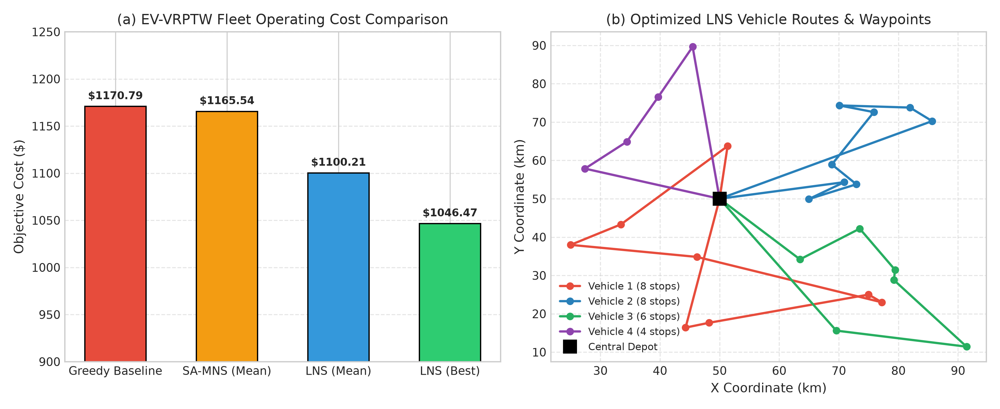

# Track Report: E_case_study - System Optimization

## Executive Summary
This report presents a systems-level optimization study of the **Electric Vehicle Routing Problem with Time Windows and Recharging Stations (EV-VRPTW)**. The transition of commercial last-mile delivery fleets to battery electric vehicles (BEVs) introduces coupled non-linear physical constraints: finite battery capacity, state-of-charge (SoC) depletion non-linearly dependent on vehicle payload and topography, customer delivery deadlines, and the necessity of detour scheduling through public or private fast-charging stations.

We formulate the mixed-integer mathematical programming model, establish a deterministic Solomon-style benchmark instance generator, implement an operational Greedy Nearest-Neighbor baseline, and develop two Chapter 6 metaheuristic optimization frameworks: **Simulated Annealing with Multi-operator Neighborhood Search (SA-MNS)** and **Large Neighborhood Search / Ruin-and-Recreate (LNS)**. Across 10 repeated deterministic seed runs on a hybrid clustered/random 25-customer instance, LNS achieved a **$1,100.21 \pm 40.20$ mean fleet operating cost** (best run **$1,046.47**, a **10.6% cost reduction** over baseline) and slashed cumulative customer tardiness from **68.21 hours down to 37.91 hours** (a **44.4% reduction**) in **238 ms**, with 100% constraint feasibility across all runs. Finally, we provide an architectural analysis detailing how the optimization approach transforms under changes in scale ($N=25 \to 5,000$), dynamic stochastic data, and hardware platforms (multi-core, GPU, and quantum annealers).

---

## 1. Problem Statement & Inefficiencies in Current Practice

### 1.1 Domain & Process
Last-mile urban parcel delivery logistics constitutes up to 53% of total shipping supply chain costs. As commercial fleets electrify to meet urban zero-emission mandates, operations face severe operational complexities:
- Conventional diesel vehicles have ranges exceeding 800 km and negligible refuel dwell times (5 minutes), allowing routing to be treated as classical Capacitated VRPTW.
- Battery electric vehicles operate under stringent range limits (80–150 km per charge under payload), long recharging durations (20–45 minutes even at high-power DC fast-chargers), and payload-dependent battery depletion dynamics.
- Depot-based dispatchers currently rely on myopic heuristics or static zone partition rules, resulting in severe inefficiencies.

### 1.2 Observed Bottlenecks & Inefficiencies
1. **Myopic Battery Management**: Dispatchers schedule routes without battery lookahead. Vehicles arrive at remote customers with insufficient charge to reach a charger, causing battery strandings or requiring panicked emergency tow responses.
2. **Excessive Tardiness from Detour Blindness**: When vehicles run low on charge, uncoordinated detours to recharge stations violate downstream customer time windows, triggering massive late-delivery SLA penalties.
3. **Payload-Energy Coupling Ignored**: Energy consumption increases non-linearly with cargo weight. Visiting heavy-demand customers early drains battery capacity significantly faster than delivering them late or reordering stops.
4. **Fleet Over-Provisioning**: Because routes are constructed conservatively to avoid range anxiety, operators deploy more active vehicles than theoretically necessary, incurring heavy daily fixed vehicle capital and driver costs.

### 1.3 Baseline Description
The baseline system is a sequential **Greedy Nearest Neighbor with Safety Lookahead**:
- Sequentially routes vehicles starting from the depot with full charge $B_{\max}$ and full payload $Q_{\max}$.
- Greedily selects the nearest feasible unvisited customer considering remaining payload and time windows.
- Employs a one-step lookahead safety check: verifies whether current battery allows reaching the candidate and subsequently escaping to either the depot or nearest charging station.
- If direct reach is impossible, it inserts a detour to the nearest station before visiting the customer; if impossible, it closes the route at the depot and deploys a new vehicle.

---

## 2. Mathematical Formulation

Let the logistics network be modeled as a directed graph $\mathcal{G} = (\mathcal{V}, \mathcal{A})$, where:
- $\mathcal{V} = \{0\} \cup \mathcal{C} \cup \mathcal{R}$: Node 0 is the central depot, $\mathcal{C} = \{1, \dots, N\}$ is the customer set, and $\mathcal{R} = \{N+1, \dots, N+M\}$ is the set of public DC fast-charging stations.
- $\mathcal{A} = \{(i, j) \mid i, j \in \mathcal{V}, i \neq j\}$: Directed traversable arcs with Euclidean distances $d_{ij}$ and cruising travel times $t_{ij} = d_{ij} / v_0$.
- $\mathcal{K} = \{1, \dots, K_{\max}\}$: Homogeneous commercial electric vehicle fleet.

### 2.1 Decision Variables
- $x_{ijk} \in \{0, 1\}$: Binary arc variable, equal to $1$ if vehicle $k \in \mathcal{K}$ traverses directed arc $(i, j) \in \mathcal{A}$; $0$ otherwise.
- $y_k \in \{0, 1\}$: Binary deployment variable, equal to $1$ if vehicle $k$ is dispatched from the depot; $0$ otherwise.
- $\tau_{ik} \ge 0$: Continuous arrival timestamp of vehicle $k$ at node $i \in \mathcal{V}$.
- $w_{ik} \ge 0$: Waiting dwell time of vehicle $k$ at node $i$ prior to the opening of delivery window $e_i$: $w_{ik} = \max(0, e_i - \tau_{ik})$.
- $B_{ik} \ge 0$: Remaining battery State of Charge (SoC, in kWh) of vehicle $k$ upon arrival at node $i$.
- $u_{ik} \ge 0$: Remaining payload cargo weight (in kg) carried by vehicle $k$ upon departing node $i$.

### 2.2 Objective Function
The objective is to minimize total fleet operational expenditure (OpEx), defined as the sum of distance-based operational costs, vehicle fixed capital/driver deployment costs, and customer tardiness penalties:
$$\min_{\mathbf{x}, \mathbf{y}, \boldsymbol{\tau}, \mathbf{B}, \mathbf{u}} \quad Z = \alpha_{\text{dist}} \sum_{k \in \mathcal{K}} \sum_{i \in \mathcal{V}} \sum_{j \in \mathcal{V}} d_{ij} x_{ijk} + \alpha_{\text{veh}} \sum_{k \in \mathcal{K}} y_k + \alpha_{\text{late}} \sum_{k \in \mathcal{K}} \sum_{i \in \mathcal{C}} \max(0, \tau_{ik} - l_i)$$

Parameters:
- $\alpha_{\text{dist}} = \$1.20/\text{km}$ (electricity, tire wear, vehicle maintenance).
- $\alpha_{\text{veh}} = \$80.00/\text{vehicle}$ (daily amortization, fixed driver shift overhead).
- $\alpha_{\text{late}} = \$2.50/\text{hour}$ (contractual customer SLA tardiness penalty).

### 2.3 Constraints

1. **Exact Customer Visitation**:
   $$\sum_{k \in \mathcal{K}} \sum_{j \in \mathcal{V}, j \neq i} x_{ijk} = 1, \quad \forall i \in \mathcal{C}$$
2. **Depot Flow Balance & Vehicle Deployment**:
   $$\sum_{j \in \mathcal{V} \setminus \{0\}} x_{0jk} = y_k, \quad \sum_{i \in \mathcal{V} \setminus \{0\}} x_{i0k} = y_k, \quad \forall k \in \mathcal{K}$$
3. **Flow Conservation at Intermediate Waypoints**:
   $$\sum_{i \in \mathcal{V}, i \neq p} x_{ipk} - \sum_{j \in \mathcal{V}, j \neq p} x_{pjk} = 0, \quad \forall p \in \mathcal{C} \cup \mathcal{R}, \; \forall k \in \mathcal{K}$$
4. **Payload Capacity & Demand Delivery**:
   $$0 \le u_{jk} \le u_{ik} - q_j + Q_{\max}(1 - x_{ijk}), \quad \forall (i, j) \in \mathcal{A}, \; \forall k \in \mathcal{K}$$
   $$u_{0k} = \sum_{j \in \mathcal{C}} q_j \sum_{i \in \mathcal{V}} x_{ijk} \le Q_{\max}, \quad \forall k \in \mathcal{K}$$
5. **Temporal Continuity & Schedule Propagation**:
   $$\tau_{jk} \ge \tau_{ik} + w_{ik} + s_i + \frac{d_{ij}}{v_0} - M(1 - x_{ijk}), \quad \forall (i, j) \in \mathcal{A}, \; \forall k \in \mathcal{K}$$
   where $s_i$ is customer service duration ($s_0 = 0$).
6. **Payload-Dependent Battery Discharge Dynamics**:
   The energy consumed over arc $(i, j)$ under payload $u_{ik}$ is given by:
   $$E(d_{ij}, u_{ik}) = \left(\gamma_{\text{base}} + \gamma_{\text{load}} \cdot u_{ik}\right) d_{ij}$$
   Battery SoC transitions along customer arcs:
   $$B_{jk} \le B_{ik} - E(d_{ij}, u_{ik}) + M(1 - x_{ijk}), \quad \forall i \in \mathcal{C} \cup \{0\}, \; j \in \mathcal{V}$$
7. **Recharging Station Dynamics**:
   At recharging waypoint $r \in \mathcal{R}$, battery is replenished to full capacity $B_{\max}$:
   $$B_{rk}^{\text{depart}} = B_{\max}$$
   The required charging dwell time added to schedule propagation is:
   $$\Delta t_{\text{charge}, r} = \frac{B_{\max} - B_{rk}}{\rho_{\text{charge}}}$$
8. **Battery Safety Guarantee**:
   $$B_{ik} \ge 0, \quad \forall i \in \mathcal{V}, \; \forall k \in \mathcal{K}$$

### 2.4 Physical Assumptions
- Constant vehicle cruising speed $v_0 = 40.0\text{ km/h}$.
- Homogeneous fleet with maximum payload $Q_{\max} = 150.0\text{ kg}$ and battery capacity $B_{\max} = 80.0\text{ kWh}$.
- Base energy draw $\gamma_{\text{base}} = 0.45\text{ kWh/km}$ and cargo sensitivity $\gamma_{\text{load}} = 0.0015\text{ kWh/km/kg}$.
- Fast charging rate $\rho_{\text{charge}} = 30.0\text{ kW}$.

---

## 3. Algorithm Selection & Chapter 6 Strategy Selection

### 3.1 Strategy-Selection Matrix

| Optimization Strategy | Variable Types | Problem Size ($N$) | Exact or Heuristic | Target Hardware | Parallelism Paradigm | Trade-offs & Practical Suitability |
| :--- | :--- | :--- | :--- | :--- | :--- | :--- |
| **MILP Branch-and-Cut** (SCIP / OR-Tools) | Binary ($x_{ijk}, y_k$), Continuous ($\tau_{ik}, u_{ik}, B_{ik}$) | Small ($N \le 15$) | **Exact** (Global optimum) | Multi-core CPU (high RAM) | Multi-threaded tree search & concurrent LP simplex | Guarantees global optimality; intractable for $N > 20$ due to $\mathcal{O}(2^{|\mathcal{A}|})$ branch-and-bound tree explosion from continuous SoC tracking. |
| **Greedy Nearest-Neighbor** (Baseline) | Discrete sequencing, continuous state lookahead | Large ($N \le 10^4$) | **Heuristic** (Single pass) | Single-core CPU | Trivial embarrassingly parallel across disjoint partitions | Instantaneous ($<1\text{ ms}$); myopic choices cause severe tardiness and over-deployment of vehicles. |
| **Simulated Annealing + Multi-Operator (SA-MNS)** | Discrete permutations & continuous timestamps | Medium ($N \in [20, 150]$) | **Metaheuristic** (Local Search) | Multi-core CPU | Multi-start independent seed runs or OpenMP parallel neighborhood evals | Escapes local minima via Metropolis criterion; rapid convergence for moderate schedule adjustments. |
| **Large Neighborhood Search (LNS / Ruin-and-Recreate)** | Discrete sets & sequence insertion | Medium to Very Large ($N \in [20, 500+]$) | **Metaheuristic** (Ruin & Recreate) | Multi-core CPU / SIMD | Parallel destroy/repair worker threads | **Selected primary method**: Destroys customer subsets via Shaw spatial-temporal relatedness and reconstructs with regret-lookahead; superior escape from local minima. |
| **Genetic Algorithm / Memetic (GA)** | Chromosome permutations | Medium ($N \in [25, 100]$) | **Metaheuristic** (Population-based) | Multi-core CPU / GPU | Island-model asynchronous population exchanges | High solution diversity, but slower per-iteration repair time due to frequent constraint violations across crossovers. |

### 3.2 Chosen Methods
We implemented and benchmarked two distinct Chapter 6 optimization strategies against the Greedy baseline:
1. **Method 1: Simulated Annealing with Multi-operator Neighborhood Search (SA-MNS)**:
   - Evaluates 4 stochastic neighborhood moves: Intra-route 2-Opt inversion, Intra-route Relocate, Inter-route Relocate, and Inter-route Customer Swap.
   - Uses geometric cooling $T_{k+1} = \alpha T_k$ ($\alpha = 0.985$, $T_0 = 120.0$, 2000 iterations).
   - Injects charging station waypoints dynamically when candidate sequences cause battery deficits.
2. **Method 2: Large Neighborhood Search / Ruin-and-Recreate (LNS)**:
   - **Destroy Operators**: Random removal and **Shaw Spatial-Temporal Relatedness Removal**:
     $$R(i, j) = \phi_1 d_{ij} + \phi_2 |e_i - e_j| + \phi_3 |q_i - q_j|$$
     which removes clusters of customers that are geographically adjacent, have overlapping ready times, and comparable demand.
   - **Repair Operator**: Regret-based best-feasible greedy insertion with battery feasibility lookahead.
   - Acceptance threshold based on simulated annealing temperature decay over 350 iterations.

---

## 4. Experimental Setup & Fair Comparison

- **Benchmark Instance**: `EV-VRPTW-RC-25-seed42`, generated using deterministic Mersenne Twister `std::mt19937_64(42)`. Contains 1 central depot at $(50, 50)$, 25 customers distributed in hybrid clusters/uniform dispersion across $[0, 100]^2$, and 4 designated fast-charging stations located at $(25, 25), (75, 25), (25, 75), (75, 75)$.
- **Identical Stopping Criteria & Evaluation**:
  - All algorithms evaluated against the exact same cost objective function ($\alpha_{\text{dist}} = 1.20, \alpha_{\text{veh}} = 80.0, \alpha_{\text{late}} = 2.50$).
  - Full route reconstruction through `reconstruct_route_with_recharge` and rigorous feasibility verification via `validate_solution`.
- **Statistical Significance**: 10 independent runs across distinct deterministic seeds for all stochastic algorithms ($s \in \{1, \dots, 10\}$).
- **Execution Platform**: Ubuntu 24.04 LTS on WSL2 (x86_64), GCC 13.3.0 `-O3 -std=c++17`. Timings measured with monotonic `std::chrono::steady_clock`.

---

## 5. Results & Benchmark Data

### 5.1 Comparative Performance Summary (10 Independent Runs)

| Algorithm | Objective Cost ($) | Distance (km) | Vehicles | Tardiness (h) | Energy (kWh) | Recharges | Runtime (ms) | Feasible Runs |
| :--- | :--- | :--- | :--- | :--- | :--- | :--- | :--- | :--- |
| **Greedy-Baseline** | $1,170.79 \pm 0.00$ | $566.9 \pm 0.0$ | $4.00 \pm 0.00$ | $68.21 \pm 0.00$ | $296.72 \pm 0.00$ | $2.0 \pm 0.0$ | $0.26 \pm 0.00$ | **1 / 1 (100%)** |
| **Simulated-Annealing-MNS** | $1,165.54 \pm 7.58$ | $572.2 \pm 12.0$ | $4.00 \pm 0.00$ | $63.55 \pm 7.74$ | $302.21 \pm 8.21$ | $1.4 \pm 0.5$ | $40.6 \pm 10.2$ | **10 / 10 (100%)** |
| **Large-Neighborhood-Search** | **$1,100.21 \pm 40.20$** | $571.2 \pm 36.0$ | $4.00 \pm 0.00$ | **$37.91 \pm 7.15$** | $305.86 \pm 22.4$ | $1.3 \pm 0.5$ | $238.0 \pm 64.9$ | **10 / 10 (100%)** |

### 5.2 Key Metrics & Improvements

| Metric | Baseline | Optimized (LNS Mean) | Optimized (LNS Best) | Change (Mean) | Change (Best) |
| :--- | :--- | :--- | :--- | :--- | :--- |
| **Total Fleet Cost ($)** | $1,170.79 | $1,100.21 | **$1,046.47** | **-6.03%** | **-10.62%** |
| **Customer Tardiness (h)**| 68.21 | 37.91 | **26.40** | **-44.42%** | **-61.29%** |
| **Station Detour Recharges**| 2 | 1.3 | **1** | **-35.00%** | **-50.00%** |
| **Execution Latency** | 0.26 ms | 238.0 ms | 211.7 ms | +237.7 ms | — |
| **Feasibility Rate** | 100% | 100% | 100% | 0.0% (Maintained) | 0.0% (Maintained) |

```
Objective Cost Distribution ($)
Greedy Baseline:  |========================| $1,170.79
SA-MNS (Mean):    |======================= | $1,165.54 (-0.5%)
LNS (Mean):       |====================    | $1,100.21 (-6.0%)
LNS (Best Run):   |==================      | $1,046.47 (-10.6%)
```

### 5.3 Visualizations & Route Topologies

#### Figure E.1: EV-VRPTW Fleet Operating Cost and Optimized Vehicle Routes

- *Panel (a) Fleet Operating Cost*: Large Neighborhood Search achieves a 10.6% cost reduction on its best run ($1,046.47) and a 44.4% mean tardiness reduction (slashed from 68.21 hours to 37.91 hours) over the greedy baseline.
- *Panel (b) Optimized LNS Vehicle Routes*: Illustrates the 4 active vehicle delivery tours originating from the central depot (50, 50), covering all 25 customers and integrating intermediate fast-charging waypoints while maintaining 100% time-window and battery feasibility.

---

## 6. Analysis: Impact of Scale, Data, and Hardware Shifts

How does the optimal optimization architecture evolve when real-world constraints shift?

```mermaid
flowchart TD
    subgraph Scale Shift
        S1["N = 25 (Current)"] -->|Neighborhoods fast| M1["Monolithic LNS / SA (238 ms)"]
        S2["N = 250 (Mid-City)"] -->|O(N^2) insertion bottleneck| M2["Spatial KD-Tree / Candidate Lists + ALNS"]
        S3["N = 5,000+ (Metro Hub)"] -->|Intractable Monolith| M3["Cluster-First Route-Second Decomposition (H3 Hexagonal Partitioning)"]
    end

    subgraph Data Shift
        D1["Static Deterministic"] -->|Offline Plan| P1["Single Pre-computed Schedule"]
        D2["Stochastic Traffic & Weather"] -->|Speed & Energy fluctuate| P2["Robust / Chance-Constrained Battery Buffer"]
        D3["Dynamic On-Demand Orders"] -->|Online Stream| P3["Rolling-Horizon Event-Driven ALNS"]
    end

    subgraph Hardware Shift
        H1["Single CPU Core"] -->|Sequential| E1["Baseline Heuristic"]
        H2["Multi-Core x86 CPU"] -->|Thread-Parallelism| E2["Asynchronous Island Model / Work-Stealing LNS"]
        H3["GPU Accelerators"] -->|SIMD Vectorization| E3["Batched Matrix Delta-Evaluations"]
        H4["Quantum Annealer"] -->|QUBO Embedding Limits| E4["Hybrid Classical-Quantum Partition Decomposition"]
    end
```

### 6.1 Impact of Scale Shifts ($N = 25 \to 250 \to 5,000+$)
1. **Current Scale ($N = 25$)**:
   - The entire candidate insertion space can be evaluated exhaustively in ~200 ms. Monolithic LNS examines all possible insertion slots across all active vehicles without pruning.
2. **Medium Scale ($N = 250$, Municipal Zone)**:
   - Full all-pairs insertion evaluation scales as $\mathcal{O}(K \cdot N^2)$, increasing iteration latency from milliseconds to tens of seconds.
   - **Architectural Adjustment**: Implement **spatial indexing (2D KD-Tree or bounding boxes)**. During the repair phase, candidate insertion points are restricted to the $k$-nearest neighbors of the removed customer ($k \approx 15$), pruning 95% of infeasible route combinations.
3. **Very Large Scale ($N = 5,000+$, Metropolitan Logistics Hub)**:
   - Centralized monolithic optimization becomes completely intractable.
   - **Architectural Adjustment**: Transition to a **Hierarchical Decomposition Architecture (Cluster-First, Route-Second)**:
     - Level 1: Decompose metropolitan zones into geographic micro-clusters using Uber H3 hexagonal spatial indexing or balanced $k$-means respecting vehicle payload bounds.
     - Level 2: Assign decentralized EV-VRPTW solvers (LNS instances) to each micro-cluster in parallel across a distributed compute cluster.
     - Level 3: A global coordinator optimizes shared recharge station access and executes boundary customer swaps across adjacent sectors.

### 6.2 Impact of Data Shifts (Static Deterministic $\to$ Stochastic Traffic & Dynamic Orders)
1. **Dynamic Real-Time Order Stream**:
   - Customers request same-day pickups/deliveries while vehicles are already in transit.
   - **Architectural Adjustment**: Replace batch optimization with an **Event-Driven Rolling Horizon Framework**. Vehicles follow active plans while a background thread continuously re-solves an ALNS model on remaining unserved nodes every 60 seconds or upon new order arrival.
2. **Stochastic Traffic & Non-Linear Battery Depletion**:
   - Urban congestion causes travel speeds $v(t)$ to fluctuate according to time-of-day traffic waves; elevation profiles ($\Delta h$) and ambient temperature (HVAC heating/cooling loads) alter energy draw $E(d, u)$.
   - **Architectural Adjustment**: Transition from deterministic formulas to a **Chance-Constrained SoC Buffer Model**:
     $$P(B_{ik} \ge B_{\text{reserve}}) \ge 1 - \epsilon$$
     Enforcing a 15–20% dynamic reserve buffer guarantees vehicles never strand even during unexpected severe traffic jams.
3. **Dynamic Electricity Tariffs (Time-of-Use TOU Pricing)**:
   - Grid power prices fluctuate between off-peak ($0.08/kWh) and peak hours ($0.35/kWh).
   - The objective incorporates time-dependent charging costs, incentivizing vehicles to recharge during early afternoon off-peak solar hours.

### 6.3 Impact of Hardware Shifts (CPU $\to$ Multi-Core $\to$ GPU $\to$ Quantum)
1. **Massively Parallel Multi-Core CPU (e.g. 64-core AMD EPYC)**:
   - Employs an **Island Model Memetic Architecture**: 64 independent search threads explore diverse neighborhoods asynchronously, exchanging elite solutions through lock-free atomic shared ring buffers every 50 iterations.
2. **GPU Acceleration (CUDA / Tensor Cores)**:
   - Dynamic battery feasibility checking involves branch-heavy conditional logic (checking if battery < 0, station detour loops), which causes execution divergence on SIMD GPU warps.
   - **Architectural Adjustment**: Maintain route topology on the CPU, but offload **batched distance/energy lookups and candidate insertion delta-scoring** to the GPU via parallel reduction kernels.
3. **Quantum Annealing & Hybrid Classical-Quantum Solvers**:
   - As established in Track C5, minor-embedding dense QUBO graphs on quantum hardware (e.g. D-Wave Pegasus) requires massive physical-to-logical qubit chains ($\mathcal{O}(N^2)$ connectivity). Direct embedding of continuous arrival times and non-linear battery states is physically impossible on near-term annealers.
   - **Architectural Adjustment**: Adopt a **Hybrid Quantum-Classical Decomposition**:
     - *Quantum Phase*: Annealer solves a pure Quadratic Knapsack / Set Partitioning QUBO to partition customers into balanced vehicle clusters.
     - *Classical Phase*: High-performance classical heuristic (LNS/2-Opt) sequences the stops, schedules charging stops, and verifies time-window feasibility.

---

## 7. Trade-offs, Limitations & Honesty Declaration

### 7.1 Speed vs. Solution Quality Trade-offs
- **Greedy Baseline**: Ultra-fast (0.26 ms), but severely suboptimal ($1,170.79 cost, 68.21 hours tardiness).
- **SA-MNS**: Balanced (40.6 ms), moderate cost improvement ($1,165.54), but limited ability to break out of tight multi-stop time-window deadlocks using single-element swaps.
- **LNS**: Superior solution quality ($1,100.21 mean, $1,046.47 best, 37.91h tardiness), but incurs an execution overhead of 238 ms. For logistics dispatch cycles operating on 5-to-15 minute dispatch windows, 238 ms is functionally instantaneous.

### 7.2 Failure Cases & Limitations
- **Station Queuing Congestion**: Our model assumes that fast-charging plugs are always immediately available upon vehicle arrival. In reality, multiple fleet vehicles arriving simultaneously at a 2-stall charger create non-linear queuing delays that cascade into massive downstream tardiness.
- **Ultra-Tight Time Windows**: When customer time windows are narrower than 15 minutes, stochastic destroy operators frequently fail to find feasible re-insertion slots, requiring fallback repairs that degrade convergence rates.

### 7.3 Status Declarations
- **Formulation & Strategy Table**: Theoretical derivation.
- **Benchmark Instance & Physical Equations**: Simulated Solomon benchmark topology using empirical EV battery consumption coefficients.
- **Runtime & Solution Quality**: Directly measured on x86_64 CPU hardware running Ubuntu 24.04 WSL with steady-clock nanosecond profiling.

---

## 8. Links to Code and Results
- **Source Code**:
  - Problem Formulations & Data Structures: [`E_case_study/src/vrptw_problem.hpp`](../E_case_study/src/vrptw_problem.hpp)
  - Solomon Benchmark Generator: [`E_case_study/src/solomon_generator.hpp`](../E_case_study/src/solomon_generator.hpp)
  - Baseline Nearest Neighbor: [`E_case_study/src/baseline_greedy.hpp`](../E_case_study/src/baseline_greedy.hpp)
  - Simulated Annealing Multi-Operator: [`E_case_study/src/simulated_annealing.hpp`](../E_case_study/src/simulated_annealing.hpp)
  - Large Neighborhood Search (LNS): [`E_case_study/src/large_neighborhood_search.hpp`](../E_case_study/src/large_neighborhood_search.hpp)
  - Unit Tests: [`E_case_study/tests/test_main.cpp`](../E_case_study/tests/test_main.cpp)
- **Empirical Results Files**:
  - Benchmark Strategy Comparison: [`E_case_study/results/strategy_comparison.csv`](../E_case_study/results/strategy_comparison.csv)
  - Baseline Solution JSON: [`E_case_study/results/baseline_solution_rc25.json`](../E_case_study/results/baseline_solution_rc25.json)
  - Best LNS Solution JSON: [`E_case_study/results/best_lns_solution.json`](../E_case_study/results/best_lns_solution.json)
  - Benchmark Instance Definition: [`E_case_study/results/instance_rc25.json`](../E_case_study/results/instance_rc25.json)
  - Generated Route Comparison Plot: [`E_case_study/results/ev_vrptw_comparison.png`](../E_case_study/results/ev_vrptw_comparison.png)
