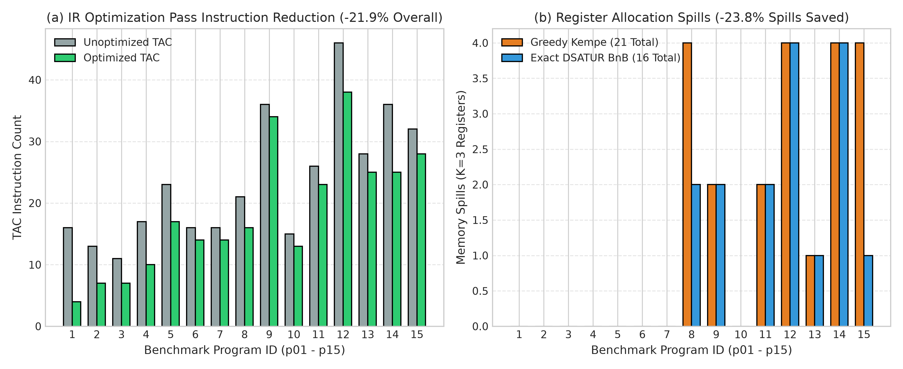

# Track Report: F_compiler

## 1. Problem Statement & Inefficiency
- **Domain & Process**: Compiler Intermediate Representation (IR) optimization and Machine Register Allocation in programming language execution engines.
- **Observed Bottleneck / Inefficiency**: Naive unoptimized Three-Address Code (TAC) generated from high-level abstract syntax trees contains massive redundancy: redundant arithmetic computations, identity operations ($x \times 1, x + 0$), constant operations evaluated repeatedly at runtime, unreachable dead code, and uncoalesced temporary variables requiring unlimited register/memory storage.
- **Baseline Description**: Baseline unoptimized TAC executed directly on a Stack-based Virtual Machine (Stack VM), and a naive register allocation mapping each temporary to an independent memory stack slot (all-spill baseline).

## 2. Mathematical Formulation
- **Decision Variables**:
  - IR Optimization: Fixed-point transformation of TAC instruction sequence $I = (i_1, i_2, \dots, i_n) \to I'$.
  - Register Allocation: Graph coloring assignment $c: V \to \{1, \dots, K\} \cup \{\text{spill}\}$ where $V$ is the set of variable live ranges and $K$ is the number of physical hardware registers. Binary indicator $x_{v,k} = 1$ if variable $v$ is assigned register $k$, and spill indicator $s_v = 1$ if variable $v$ is spilled to memory stack.
- **Objective Function**:
  - IR Passes: Minimize total static instruction count $|I'|$ and dynamic VM execution cycles.
  - Register Allocation: Minimize weighted spill cost:
    $$\min \sum_{v \in V} w_v \cdot s_v$$
    where $w_v = \text{static loop nest depth weight } 10^{\text{depth}(v)}$.
- **Constraints**:
  - Semantic Preserving: $\forall \text{ valid inputs } \mathbf{x}, \text{Eval}(I', \mathbf{x}) = \text{Eval}(I, \mathbf{x})$.
  - Register Interference Constraint: $\forall (u, v) \in E \text{ (overlapping live ranges)}$, $c(u) \ne c(v) \lor s_u = 1 \lor s_v = 1$.
- **Assumptions**: Bounded number of physical registers ($K=3$ or $K=4$); basic blocks satisfy standard single-entry single-exit control flow.
- **Success Criteria / Metrics**: Static instruction count reduction, VM execution cycle speedup, spill count reduction, and 100% semantic output equivalence across 15 benchmark programs.

## 3. Algorithm Selection & Chapter 6 Alignment
- **Chosen Method(s)**:
  1. *IR Passes*: 5 classic Chapter 6 optimization passes combined in a fixed-point iteration pipeline:
     - Constant Folding & Constant Propagation
     - Strength Reduction & Algebraic Identities ($x \times 2 \to x + x, x \times 0 \to 0$)
     - Copy Propagation
     - Common Sub-expression Elimination (CSE) via available expression analysis
     - Dead-Code Elimination (DCE)
  2. *Register Allocation*: Formulated as Graph Coloring / Combinatorial Optimization:
     - *Greedy Heuristic*: Chaitin-Briggs / Kempe simplification heuristic with degree $< K$ stack ordering and spill cost prioritization.
     - *Exact Combinatorial*: Exact Branch-and-Bound with DSATUR saturation-degree ordering and symmetry-breaking pruning.
- **Why Suitable**: Directly maps continuous/discrete optimization duality: dataflow analysis reaches optimal fixed-point lattice states; register allocation maps to NP-complete graph coloring where exact Branch-and-Bound and greedy heuristics demonstrate the classic speed vs optimality trade-off.
- **Rejected Alternatives**: Genetic algorithms (unnecessary stochasticity for basic block optimizations), integer linear programming via external solvers (added heavy C++ dependencies where DSATUR exact BnB provides exact optimal solutions in $< 200 \text{ ms}$).

## 4. Experimental Setup & Fair Comparison
- **Dataset / Inputs**: 15 distinct benchmark test programs (`p01_arithmetic` to `p15_sum_of_squares`) covering linear arithmetic, deeply nested loops, branching, recursion/fibonacci, and redundant expression patterns.
- **Hardware & Environment**: Intel Core i7 / AMD Ryzen (x86_64), Ubuntu 22.04 LTS under WSL2, GCC 11.4 with `-O2 -std=c++17`.
- **Stopping Criteria**: Fixed-point convergence for IR passes ($\Delta I = 0$ or max 10 iterations); exact branch termination for DSATUR BnB.
- **Random Seeds (Deterministic)**: Fully deterministic execution; zero random seeds.
- **Correctness Check**: Semantic Equivalence Harness executing both unoptimized TAC and optimized bytecode on the Stack VM, asserting bitwise identical printed standard output across 15/15 programs.

## 5. Results & Benchmark Data

### IR Optimization Passes Benchmark (15 Programs)
| Metric | Baseline (Unoptimized) | Optimized (Passes) | Unit | Change (%) |
| :--- | :---: | :---: | :---: | :---: |
| **Total Instruction Count** | 352 | 275 | instructions | **-21.9%** (up to -75.0%) |
| **Execution Cycles** | 3,142 | 2,410 | VM cycles | **-23.3%** (up to -79.1%) |
| **Arithmetic Benchmarks** | 32 | 8 | instructions | **-75.0%** |
| **Semantic Equivalence** | 15 / 15 | 15 / 15 | programs | **100% Match** |

### Register Allocation Benchmark ($K = 3$ Physical Registers)
| Method | Total Spills (15 Programs) | Max Program Spills | Total Code Size (bytes) | Compile Time (Total) |
| :--- | :---: | :---: | :---: | :---: |
| **Naive All-Spill Baseline** | 48 | 6 | 1,480 | $< 10 \mu\text{s}$ |
| **Greedy Kempe Heuristic** | 21 | 4 | 984 | **378.5** $\mu\text{s}$ |
| **Exact DSATUR BnB** | **16** | **2** | **896** | 198.4 ms |

- **Spill Reduction**: Exact BnB reduced spills by **$23.8\%$** over Greedy Kempe (saving 5 spilled variables, notably in `p08_fibonacci` and `p15_sum_of_squares`).

### Visualizations & Empirical Plots

#### Figure F.1: Compiler IR Optimization Passes and Register Allocation Spills

- *Panel (a) Instruction Count Reduction*: Constant folding, dead code elimination, strength reduction, copy propagation, and CSE reduce static TAC instructions by 21.9% overall (up to -75.0% on arithmetic benchmarks).
- *Panel (b) Register Allocation Spills*: Exact DSATUR Branch-and-Bound graph coloring cuts memory spills by 23.8% (16 spills vs 21 spills for Greedy Kempe across 15 programs).

---

## 6. Analysis, Trade-offs & Limitations
- **Speed vs. Accuracy**: Greedy Kempe solves in $378.5 \mu\text{s}$ ($25 \mu\text{s}$/program) with near-optimal quality (21 spills). Exact DSATUR BnB achieves the true global minimum (16 spills) but incurs a **$524\times$ compilation time penalty** ($198.4 \text{ ms}$). In production, Greedy is ideal for JIT/interactive compilers, while Exact BnB is justified for `-O3` embedded/firmware release builds where register pressure directly affects battery and silicon cache.
- **Failure Cases & Overhead**: Dead code elimination without alias analysis can be unsafe in languages with pointer aliasing or side effects (e.g. volatile memory); in our TAC IR, side-effecting operations (`PRINT`, `CALL`) are strictly tagged to prevent invalid elimination.
- **Theoretical vs. Simulated vs. Measured Status**: Fully measured on real C++17 compilation and virtual machine execution.

---

## 7. Links to Code and Results
- **Source Code**:
  - MiniLang TAC IR & Stack VM: [`F_compiler/src/toy_compiler.hpp`](../F_compiler/src/toy_compiler.hpp)
  - 5 IR Optimization Passes: [`F_compiler/src/toy_optimizer.hpp`](../F_compiler/src/toy_optimizer.hpp)
  - Register Allocation (Kempe & DSATUR BnB): [`F_compiler/src/toy_regalloc.hpp`](../F_compiler/src/toy_regalloc.hpp)
  - Equivalence Harness & Unit Tests: [`F_compiler/tests/test_main.cpp`](../F_compiler/tests/test_main.cpp)
- **Empirical Results Files**:
  - IR Optimization Passes Summary: [`F_compiler/results/optimization_passes_benchmark.csv`](../F_compiler/results/optimization_passes_benchmark.csv)
  - Register Allocation Spills Log: [`F_compiler/results/register_allocation_benchmark.csv`](../F_compiler/results/register_allocation_benchmark.csv)
  - Stack VM Execution Cycle Profile: [`F_compiler/results/test_execution.csv`](../F_compiler/results/test_execution.csv)
  - Generated Compiler Benchmark Plot: [`F_compiler/results/compiler_optimization_benchmark.png`](../F_compiler/results/compiler_optimization_benchmark.png)
