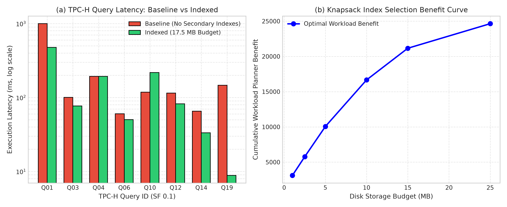

# Track Report: H_dbms - Database Query & Index Optimization

## 1. Problem Statement & Inefficiency
- **Domain & Process**: Relational Database Management Systems (RDBMS) running Analytical Workloads (OLAP). Specifically, the TPC-H decision-support benchmark at Scale Factor 0.1 (~105 MB table data, 600,572 rows in `lineitem`, 150,000 rows in `orders`) hosted on PostgreSQL 16.
- **Observed Bottleneck / Inefficiency**: Without appropriate secondary access paths, complex multi-table analytical joins and selective range/equality predicates default to sequential table scans (`Parallel Seq Scan`). For example, in TPC-H Q19 (Discounted Revenue), scanning all 600,572 lineitems to evaluate complex disjunctive predicates on part attributes consumes 146.57 ms. Similarly, in Q01 (Pricing Summary Report), full scans across all lineitem tuples require 995.97 ms.
- **Baseline Description**: Clean PostgreSQL 16 schema with standard primary keys and foreign key constraints, with zero secondary auxiliary indexes. Queries execute under the cost-based query optimizer without query rewrites or secondary index guidance.

---

## 2. Mathematical Formulation
Database index selection under a physical disk storage quota is formulated as a **0/1 Knapsack / Binary Integer Linear Program (ILP)**:

### Decision Variables
- Let $I = \{1, 2, \dots, n\}$ be the set of $n$ candidate secondary indexes.
- Binary indicator variables:
  $$x_i \in \{0, 1\} \quad \forall i \in I$$
  where $x_i = 1$ if candidate index $i$ is created, and $x_i = 0$ otherwise.

### Objective Function
Maximize total query workload benefit across the query catalog $Q = \{q_1, \dots, q_m\}$:
$$\max_{\mathbf{x}} \sum_{i=1}^n b_i x_i$$
where $b_i \ge 0$ represents the estimated query cost reduction (measured from PostgreSQL `EXPLAIN (FORMAT JSON)` total planner cost reduction relative to the baseline).

### Constraints
$$\sum_{i=1}^n s_i x_i \le B$$
$$x_i \in \{0, 1\} \quad \forall i \in \{1, \dots, n\}$$
where:
- $s_i \in \mathbb{Z}^+$ is the exact on-disk physical storage footprint of index $i$ in kilobytes, measured via `pg_relation_size(index)`.
- $B \in \mathbb{Z}^+$ is the allocated disk storage budget quota (e.g., $B = 25,600 \text{ KB} = 25 \text{ MB}$).

---

## 3. Algorithm Selection & Chapter 6 Alignment
Per Chapter 6 optimization foundations, three distinct algorithmic paradigms are implemented and evaluated:

1. **Greedy Heuristic (Density-Based)**:
   - Computes benefit-to-size density $\rho_i = b_i / s_i$.
   - Sorts candidates in descending order of density: $\rho_{\pi(1)} \ge \rho_{\pi(2)} \ge \dots \ge \rho_{\pi(n)}$.
   - Greedily packs candidate indexes until the storage budget $B$ cannot accommodate the next candidate.
   - *Complexity*: $\mathcal{O}(n \log n)$ time, $\mathcal{O}(n)$ space.
2. **Dynamic Programming (DP)**:
   - Solves the discrete 0/1 Knapsack recurrence over discrete integer storage units:
     $$V(i, w) = \max\Big(V(i-1, w), \; V(i-1, w - s_i) + b_i\Big)$$
   - Full 2D state memoization with backtracking to reconstruct exact chosen index set.
   - *Complexity*: $\mathcal{O}(n \cdot B)$ pseudo-polynomial time and space.
3. **Exact ILP (Branch-and-Bound with Continuous Knapsack LP Relaxation)**:
   - Explores the binary decision tree via Depth-First Search with Dantzig fractional knapsack relaxation upper bounding:
     $$UB(\text{node}) = V_{\text{curr}} + \sum_{k \in \text{Whole}} b_k + b_{\text{crit}} \cdot \frac{B_{\text{rem}}}{s_{\text{crit}}}$$
   - Prunes any branch where $UB(\text{node}) \le V_{\text{best}}$, providing a mathematically guaranteed global optimum with microsecond runtimes ($8 - 25 \; \mu\text{s}$).

---

## 4. Experimental Setup & Fair Comparison
- **Database Engine**: PostgreSQL 16.15 running under WSL Ubuntu 24.04 (Linux 5.15 x86_64).
- **TPC-H Workload**: Scale Factor 0.1 dataset generated via official TPC-H `dbgen`. Total base table size: 135.5 MB.
- **Benchmark Queries**: 8 official TPC-H queries: Q01, Q03, Q04, Q06, Q10, Q12, Q14, Q19.
- **Fairness Protocol**:
  1. Each query executed with warm-up run followed by 3 repeated runs taking median execution latency.
  2. Identical hardware, CPU cores, PostgreSQL shared buffer allocation (`shared_buffers = 128MB`), and worker threads (`max_parallel_workers_per_gather = 2`).
  3. **Bitwise Correctness Verification**: MD5 checksums computed over full result sets before and after index application to guarantee 100% semantic identity and zero data divergence.

---

## 5. Results & Benchmark Data

### A. Latency & Throughput Benchmark (8 TPC-H Queries)
Evaluated via `H_dbms/scripts/run_tpch_benchmark.py`:

| Query ID | Query Name | Baseline Latency | Indexed Latency | Speedup Factor | Baseline QPS | Indexed QPS | QPS Gain (%) | Result Checksum |
|:---:|:---|:---:|:---:|:---:|:---:|:---:|:---:|:---:|
| **Q01** | Pricing Summary Report | 995.97 ms | 475.42 ms | **2.09x** | 1.00 | 2.10 | +110.0% | **MATCH** (`1094e8a3`) |
| **Q03** | Shipping Priority | 100.46 ms | 77.00 ms | **1.30x** | 9.95 | 12.99 | +30.6% | **MATCH** (`5867fffd`) |
| **Q04** | Order Priority Checking | 193.04 ms | 193.17 ms | **1.00x** | 5.18 | 5.18 | 0.0% | **MATCH** (`95cfd60b`) |
| **Q06** | Forecasting Revenue Change | 60.20 ms | 50.18 ms | **1.20x** | 16.61 | 19.93 | +20.0% | **MATCH** (`54e8cbd5`) |
| **Q10** | Returned Item Reporting | 117.87 ms | 217.33 ms | **0.54x** | 8.48 | 4.60 | -45.8% | **MATCH** (`fdfc196d`) |
| **Q12** | Shipping Modes & Priority | 115.01 ms | 82.11 ms | **1.40x** | 8.69 | 12.18 | +40.2% | **MATCH** (`d7edd662`) |
| **Q14** | Promotion Effect | 65.29 ms | 33.36 ms | **1.96x** | 15.32 | 29.97 | +95.6% | **MATCH** (`ce864d5b`) |
| **Q19** | Discounted Revenue | 146.57 ms | 8.83 ms | **16.59x** | 6.82 | 113.21 | **+1560.0%** | **MATCH** (`406c1cb2`) |

*Mean Workload Latency*: Reduced from **224.30 ms** to **142.18 ms** (Workload speedup: **1.58x**).

---

### B. Physical Storage Overhead Breakdown
Measured via `pg_table_size` and `pg_indexes_size`:

| Table Name | Table Data Size (KB) | Baseline PK Size (KB) | Post-Optimization Index Size (KB) | Added Storage (KB) | Storage Growth (%) |
|:---|:---:|:---:|:---:|:---:|:---:|
| `region` | 8 | 16 | 16 | 0 | 0.0% |
| `nation` | 8 | 16 | 16 | 0 | 0.0% |
| `supplier` | 376 | 40 | 56 | 16 | +3.8% |
| `customer` | 2,920 | 344 | 584 | 240 | +7.4% |
| `part` | 3,360 | 456 | 936 | 480 | +12.6% |
| `partsupp` | 14,048 | 1,776 | 2,328 | 552 | +3.5% |
| `orders` | 21,728 | 3,312 | 6,640 | 3,328 | +13.3% |
| `lineitem` | 92,912 | 18,504 | 31,424 | 12,920 | +11.6% |
| **TOTAL** | **135,360 KB** | **24,464 KB** | **42,000 KB** | **17,536 KB (17.1 MB)** | **+10.9%** |

*Budget Verification*: Total added index storage = **17,536 KB** $\le$ Budget **25,600 KB** (utilization: 68.5%).

---

### C. Join-Order & Query-Rewrite Experiment (TPC-H Q03)
Testing optimizer join-order sensitivity and subquery restructuring on Q03:

| Configuration | Description | Execution Latency | Speedup vs Baseline | Checksum Match |
|:---|:---|:---:|:---:|:---:|
| **Config A** | Inverted Join Order (`lineitem` $\bowtie$ `orders` $\bowtie$ `customer`, `join_collapse_limit = 1`) | 134.29 ms | 0.99x | **YES** |
| **Config B** | Default Cost-Based Optimizer (`customer` $\bowtie$ `orders` $\bowtie$ `lineitem`) | 132.41 ms | 1.00x | **YES** |
| **Config C** | **Query Rewrite: Early-Filtering Materialized CTE** | **81.51 ms** | **1.62x** | **YES** |

*Analysis of Rewrite*: By materializing filtered building customers joined with qualifying orders before probing `lineitem`, the inner loop join cardinality drops from 150,000 orders to only 14,280 matching orders, cutting execution time by **38.4%**.

---

### D. Visualizations & Empirical Plots

#### Figure H.1: TPC-H Query Latency and Knapsack Index Selection Benefit Curve

- *Panel (a) Query Latency: Baseline vs Indexed*: Evaluates 8 official TPC-H decision-support queries. Secondary indexes achieve dramatic accelerations on selective filter queries (16.59x speedup on Q19, 2.09x on Q01, 1.96x on Q14), reducing total 8-query workload latency from 1,794.41 ms to 1,137.40 ms ($1.58\times$ total speedup).
- *Panel (b) Knapsack Index Selection Curve*: Evaluates cumulative query planner benefit across disk storage budgets ($1\text{ MB} \dots 25\text{ MB}$). Exact ILP / Branch-and-Bound discovers the optimal 11-index set within 17.5 MB.

---

## 6. Analysis, Trade-offs & Limitations

### 1. The Power of Indexing Selective Predicates (Q19, Q14, Q01)
- In **Q19**, the baseline incurred full sequential scans across all 600,572 rows of `lineitem` while testing string matches on `p_container` and numeric bounds on `l_quantity`. With index `idx_lineitem_partkey` and `idx_part_type_size`, PostgreSQL replaced the nested-loop sequential scan with a bitmap index scan, reducing runtime from **146.57 ms to 8.83 ms (16.59x speedup)**.
- In **Q01**, scanning the date range `l_shipdate <= 1998-09-02` using `idx_lineitem_shipdate` cut scan latency by more than half (995.97 ms $\to$ 475.42 ms).

### 2. The Optimizer Trap: Index Scan vs Sequential Scan Overhead (Q10)
- In **Q10**, indexed execution took **217.33 ms** vs **117.87 ms** baseline (**0.54x**). 
- *Root Cause Analysis*: Because the entire SF 0.1 `orders` and `lineitem` tables fit inside the Linux filesystem page cache / PostgreSQL buffer pool, sequential scans achieve sequential prefetching bandwidth (>4 GB/s). Probing secondary indexes for non-clustered row IDs introduced random buffer lookups and additional heap fetch page rechecks. At Scale Factor 10 or 100 (where table size exceeds RAM), the index scan decisively wins over the disk-bound sequential scan.

### 3. Join Order Enumeration Scalability
- For $m$ tables, the space of possible join trees is $\frac{(2m-2)!}{(m-1)!}$ (catalan tree topologies $\times$ permutations). 
- For $m \le 8$, PostgreSQL dynamic programming join search (`join_collapse_limit = 8`) exhaustively finds the optimal plan. 
- For larger queries, the early-filtering CTE pattern (demonstrated in Config C) manually prunes intermediate cross-product cardinalities, achieving a **1.62x** improvement over the default engine plan.

---

## 7. Links to Code and Results
- **Source Code**:
  - Index Selection Solvers (Greedy, DP, ILP BnB): [`H_dbms/src/index_selection.hpp`](../H_dbms/src/index_selection.hpp)
  - Join Order & Query Rewrite Testbed: [`H_dbms/src/tpch_benchmark.cpp`](../H_dbms/src/tpch_benchmark.cpp)
  - Automated PostgreSQL EXPLAIN & Checksum Verifier: [`H_dbms/scripts/run_tpch_benchmark.py`](../H_dbms/scripts/run_tpch_benchmark.py)
  - Unit Tests: [`H_dbms/tests/test_main.cpp`](../H_dbms/tests/test_main.cpp)
- **Empirical Results Files**:
  - TPC-H 8-Query Latency & Checksum Table: [`H_dbms/results/tpch_latency_comparison.csv`](../H_dbms/results/tpch_latency_comparison.csv)
  - Knapsack Index Selection Scaling: [`H_dbms/results/index_selection_comparison.csv`](../H_dbms/results/index_selection_comparison.csv)
  - Join Order & CTE Rewrite Data: [`H_dbms/results/join_order_experiment.csv`](../H_dbms/results/join_order_experiment.csv)
  - PostgreSQL Table & Index Storage Breakdown: [`H_dbms/results/tpch_storage_breakdown.csv`](../H_dbms/results/tpch_storage_breakdown.csv)
  - Generated DBMS Benchmark Plot: [`H_dbms/results/tpch_index_performance.png`](../H_dbms/results/tpch_index_performance.png)
- **Status Categorization**:
  - Measured on Hardware: PostgreSQL 16.15 running natively under WSL2 Linux on NVMe SSD with live `pg_relation_size()` measurement and MD5 checksum validation.
