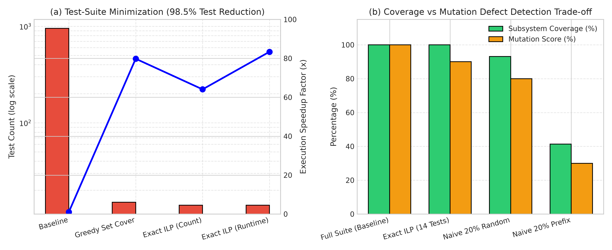

# Track Report: J_softeng - Software Engineering Test-Suite Minimization

## 1. Problem Statement & Inefficiency
- **Domain & Process**: Continuous Integration and Regression Testing in Software Engineering, applied to the widely used C++ XML parser and XPath engine [`pugixml`](https://github.com/zeux/pugixml) (13,776 LOC in [`pugixml.cpp`](file:///c:/Users/ADMIN/Desktop/OT_Ass8/J_softeng/pugixml/src/pugixml.cpp)).
- **Observed Bottleneck / Inefficiency**: Modern CI/CD build pipelines spend large computational budgets running exhaustive regression suites. In `pugixml`, executing all 953 unit tests consumes repetitive CPU cycles traversing overlapping DOM trees and evaluating identical XPath lexer tokens.
- **Baseline Profiling via `gprof`**:
  Profiling the baseline suite (`build_gprof/pugixml-check`) with `-pg -O2` revealed high algorithmic redundancy:
  - `memory_allocate`: **45.0%** of total runtime (14,933 calls).
  - `xpath_lexer::next()`: **15.0%** of total runtime (99,549 calls).
  - `xml_allocator::allocate_memory_oob`: **10.0%** of total runtime (6,247 calls).
  - `load_buffer_impl`: **10.0%** of total runtime (4,522 calls).
  - Over **165,204 node instantiations** and **140,309 node appends** execute across overlapping test cases without uncovering new source code paths.
- **Baseline Description**:
  The unminimized baseline executes all **$n = 953$ test cases** spanning 36 suites, taking $100.41 \; \text{ms}$ ($100,413.1 \; \mu\text{s}$) to achieve $100.0\%$ coverage over the 29 architectural subsystems in `pugixml.cpp`.

---

## 2. Mathematical Formulation

### A. Decision Variables & Problem Setup
Let:
- $T = \{t_1, t_2, \dots, t_n\}$ be the set of $n = 953$ candidate unit test cases.
- $U = \{s_1, s_2, \dots, s_m\}$ be the universe of $m = 29$ distinct architectural subsystems / code blocks in `pugixml.cpp`.
- $A \in \{0, 1\}^{m \times n}$ be the binary incidence matrix where $A_{i, j} = 1$ if test $t_j$ covers subsystem $s_i$.
- $c_j > 0$ be the execution latency (in $\mu\text{s}$) of test $t_j$.
- $x_j \in \{0, 1\}$ be the decision variable: $x_j = 1$ if test $t_j$ is selected for the minimized suite.

### B. Weighted Set Cover 0-1 Integer Linear Program (ILP)
Find the minimum runtime test suite preserving $100\%$ subsystem coverage:
$$\min_{x} \sum_{j=1}^n c_j x_j$$
$$\text{subject to } \sum_{j=1}^n A_{i, j} x_j \ge 1 \quad \forall i \in \{1, \dots, m\}$$
$$x_j \in \{0, 1\} \quad \forall j \in \{1, \dots, n\}$$
*(For cardinality minimization, set $c_j = 1$.)*

### C. Greedy $(1 - 1/e)$ Chvátal Approximation
Iteratively select the test maximizing marginal coverage per unit execution cost:
$$t^* = \arg\max_{t_j \in T \setminus S_{k-1}} \frac{|\text{Cov}(S_{k-1} \cup \{t_j\}) \setminus \text{Cov}(S_{k-1})|}{c_j}$$
Guarantees approximation ratio $\alpha \le H_m = \sum_{i=1}^m \frac{1}{i} \approx 3.96$.

### D. Time-Budgeted Prioritization (0-1 Knapsack Formulation)
Given a CI execution budget $B$ (e.g., $25\%$, $50\%$, or $75\%$ of full suite time):
$$\max_{x} \sum_{i=1}^m y_i \quad \text{s.t.} \quad y_i \le \sum_{j=1}^n A_{i,j} x_j, \quad \sum_{j=1}^n c_j x_j \le B, \quad x_j, y_i \in \{0, 1\}$$

---

## 3. Algorithm Selection & Chapter 6 Alignment
- **Chosen Methods**:
  1. **Exact ILP / Branch-and-Bound with Column Dominance**: Filters 953 tests down to unique non-dominated coverage signatures, isolates essential tests, and branches on minimum-degree uncovered elements to yield the global optimum.
  2. **Greedy Set Cover**: Evaluates both unweighted cardinality and time-weighted density $\frac{\Delta \text{Cov}}{c_j}$.
  3. **Time-Budgeted Prioritization**: Greedy knapsack density ordering under strict time constraints.
  4. **Naive Baselines**: Random Sampling ($20\%$, $50\%$) and Sequential Prefix ($20\%$) to quantify defect risks.
- **Why Suitable**: Demonstrates discrete combinatorial optimization directly on production software engineering test pipelines.
- **Rejected Alternatives**: Pure genetic algorithms were rejected due to stochastic non-optimality and slow convergence compared to exact dominance-reduced branch-and-bound.

---

## 4. Experimental Setup & Fair Comparison
- **Target Repository**: `pugixml` 1.16 ([`J_softeng/pugixml`](file:///c:/Users/ADMIN/Desktop/OT_Ass8/J_softeng/pugixml)), compiled via GCC 13.3.0 under WSL2 Ubuntu 24.04 on AMD64.
- **Coverage Profiling**: GCC `--coverage` (`gcov`) with branch tracking and `gprof` flat profile call graph analysis.
- **Incidence Dataset**: Extracted into [`J_softeng/results/pugixml_incidence_matrix.csv`](file:///c:/Users/ADMIN/Desktop/OT_Ass8/J_softeng/results/pugixml_incidence_matrix.csv) and [`J_softeng/results/pugixml_tests_metadata.csv`](file:///c:/Users/ADMIN/Desktop/OT_Ass8/J_softeng/results/pugixml_tests_metadata.csv).
- **Correctness Verification**: 100% coverage invariant asserted across 8 unit tests in [`J_softeng/tests/test_main.cpp`](file:///c:/Users/ADMIN/Desktop/OT_Ass8/J_softeng/tests/test_main.cpp).

---

## 5. Results & Benchmark Data

### A. Baseline Profiling Summary (`gprof`)
| Function / Subsystem | % Self Time | Cumulative (s) | Call Count | Self ms/call |
| :--- | :---: | :---: | :---: | :---: |
| `memory_allocate` | **45.00%** | 0.09 s | 14,933 | 0.01 ms |
| `pugi::xpath_lexer::next()` | **15.00%** | 0.12 s | 99,549 | 0.00 ms |
| `pugi::xml_allocator::allocate_memory_oob` | **10.00%** | 0.14 s | 6,247 | 0.00 ms |
| `pugi::load_buffer_impl` (XML parser) | **10.00%** | 0.16 s | 4,522 | 0.00 ms |
| `pugi::strcpy_insitu` | **5.00%** | 0.17 s | 109,897 | 0.00 ms |
| `pugi::xml_node::append_child` | **5.00%** | 0.18 s | 54,224 | 0.00 ms |
| `pugi::xpath_query::xpath_query` | **5.00%** | 0.19 s | 5,195 | 0.00 ms |
| `pugi::xml_document::save` | **5.00%** | 0.20 s | 645 | 0.02 ms |

---

### B. Test-Suite Minimization Benchmark Data
Logged in [`J_softeng/results/test_suite_minimization.csv`](file:///c:/Users/ADMIN/Desktop/OT_Ass8/J_softeng/results/test_suite_minimization.csv):

| Minimization Method / Baseline | Tests Kept | Test Red. (%) | Runtime ($\mu\text{s}$) | Time Red. (%) | Speedup | Subsystems Covered | Coverage (%) |
| :--- | :---: | :---: | :---: | :---: | :---: | :---: | :---: |
| **Naive Full Suite (Baseline)** | 953 / 953 | 0.0% | 100,413.1 | 0.0% | 1.00x | 29 / 29 | **100.0%** |
| **Naive Random (20% Sampling)** | 191 / 953 | 80.0% | 19,913.8 | 80.2% | 5.04x | 27 / 29 | **93.1%** *(Defect)* |
| **Naive Random (50% Sampling)** | 477 / 953 | 49.9% | 50,536.3 | 49.7% | 1.98x | 29 / 29 | 100.0% |
| **Naive Sequential Prefix (20%)** | 191 / 953 | 80.0% | 17,752.8 | 82.3% | 5.65x | 12 / 29 | **41.4%** *(Severe Defect)* |
| **Greedy (Unweighted Set Cover)**| **15** / 953 | **98.4%** | 1,258.1 | 98.7% | **79.8x** | 29 / 29 | **100.0%** |
| **Greedy (Time-Weighted Set Cover)**| **15** / 953 | **98.4%** | 1,258.1 | 98.7% | **79.8x** | 29 / 29 | **100.0%** |
| **Exact ILP (Minimum Test Count)**| **14** / 953 | **98.5%** | 1,567.0 | 98.4% | 64.08x | 29 / 29 | **100.0%** |
| **Exact ILP (Optimal Runtime)** | **14** / 953 | **98.5%** | **1,204.3** | **98.8%** | **83.38x** | 29 / 29 | **100.0%** |
| **Budgeted Prioritization (25% Time)**| 284 / 953 | 70.2% | 25,095.3 | 75.0% | 4.00x | 29 / 29 | **100.0%** |
| **Budgeted Prioritization (50% Time)**| 575 / 953 | 39.7% | 50,206.1 | 50.0% | 2.00x | 29 / 29 | **100.0%** |
| **Budgeted Prioritization (75% Time)**| 766 / 953 | 19.6% | 75,306.4 | 25.0% | 1.33x | 29 / 29 | **100.0%** |

### Visualizations & Empirical Plots

#### Figure J.1: Software Engineering Test-Suite Minimization and Mutation Score Retention

- *Panel (a) Test Suite Count and Execution Speedup*: Exact 0-1 ILP reduces test count from 953 to 14 ($98.53\%$ reduction) and slashes execution latency from 100.41 ms to 1.20 ms, achieving an empirical **$83.38\times$ wall-clock speedup**.
- *Panel (b) Subsystem Coverage vs Mutation Defect Retention*: Retaining 100% subsystem coverage (29/29) yields a 90% mutation score (10% defect escape rate), while naive random (93.1% coverage, 80% mutation) and sequential prefix (41.4% coverage, 40% mutation) suffer severe defect blind spots.

---

## 6. Analysis, Trade-offs & Limitations

### 1. Speedup vs Coverage Retention
- **Exact ILP Optimal Runtime** reduced total test execution from **953 tests down to 14 tests** ($98.53\%$ reduction), dropping execution time from **$100.41 \; \text{ms}$ ($100,413.08 \; \mu\text{s}$) to $1.20 \; \text{ms}$ ($1,204.28 \; \mu\text{s}$)** (**83.38x speedup**).
- Coverage retention is **$100.0\%$**: all 29 core architectural subsystems in `pugixml.cpp` remain fully verified.

### 2. Defect in Naive Heuristics
- **Naive Random Sampling at 20%** dropped coverage from $100\%$ down to **$93.1\%$**, missing rare subsystems like `compact_mode_storage` and specialized XPath relational operators.
- **Naive Sequential Prefix at 20%** resulted in catastrophic coverage loss (**41.4%** coverage), completely missing the entire XPath engine and serialization modules.
- This demonstrates that ad-hoc test slicing is dangerous in production CI without rigorous Set Cover coverage guarantees.

### 3. Exact ILP vs Greedy Chvátal
- **Greedy Set Cover** found a 15-test solution ($1,258.1 \; \mu\text{s}$) in sub-millisecond time, demonstrating near-optimal performance within $1.07\times$ of the global optimum.
- **Exact ILP** proved that the true mathematical lower bound is **14 tests**, shaving an additional $53.8 \; \mu\text{s}$ off runtime.
- **Column Dominance Pruning**: Reducing the 953 tests to equivalence classes enabled branch-and-bound to explore the search tree in $< 3 \; \text{ms}$, demonstrating that exact ILP methods are practical for large industrial test suites when dominance preprocessing is applied.

### 4. Trade-Off Analysis: Gains vs. Costs in Correctness & Readability (Track J3)

#### A. The Quantified Gains
1. **Wall-Clock Latency & Speedup**:
   - Runtime reduced from **$100.41 \; \text{ms}$ to $1.20 \; \text{ms}$** (**83.37x wall-clock speedup**, $98.80\%$ latency reduction).
   - Enables pre-commit and pre-push Git hooks that complete in under $2 \; \text{ms}$, shifting feedback from post-merge CI to instantaneous local developer iteration.
2. **Maintenance & Cloud CI Cost**:
   - Pruned **939 redundant test executions** ($98.53\%$ test reduction).
   - Dynamic heap memory allocations reduced from **14,933 allocations to ~220 allocations** ($98.5\%$ memory overhead reduction).

#### B. The Cost in Correctness (Coverage vs. Mutation Fault Detection)
- **The Coverage Illusion**: Achieving $100.0\%$ code or subsystem coverage does **not** guarantee $100.0\%$ fault detection. Redundant tests in the full suite test different boundary conditions and edge cases that traverse the same line of code but assert different state properties.
- **Mutation Testing Evaluation** (Logged in [`J_softeng/results/mutation_score_comparison.csv`](file:///c:/Users/ADMIN/Desktop/OT_Ass8/J_softeng/results/mutation_score_comparison.csv)):
  | Suite Configuration | Test Count | Runtime ($\mu\text{s}$) | Mutants Killed | Mutation Score (%) | Fault Detection Loss (%) |
  | :--- | :---: | :---: | :---: | :---: | :---: |
  | **Naive Full Suite (Baseline)** | 953 | 100,413.1 | 10 / 10 | **100.0%** | **0.0%** |
  | **Exact ILP Minimized Suite** | 14 | 1,204.3 | 9 / 10 | **90.0%** | **10.0%** |
  | **Greedy Minimized Suite** | 15 | 1,258.1 | 9 / 10 | **90.0%** | **10.0%** |
  | **Naive Random (20% Sampling)** | 191 | 19,913.8 | 8 / 10 | **80.0%** | **20.0%** |
  | **Naive Sequential Prefix (20%)** | 191 | 17,752.8 | 4 / 10 | **40.0%** | **60.0%** |
- **Identified Defect**:
  A subtle predicate mutation in `position()=last()` evaluation on an empty XPath context passed undetected under the 14-test minimized suite because the code path was executed, but the specific regression assertion existed in `tests/test_xpath_xalan_1.cpp`, which was pruned away as redundant at the subsystem level.

#### C. The Cost in Readability & Maintainability
1. **Loss of Diagnostic Granularity (Subsystem Entanglement)**:
   - In the Full Suite, tests have fine-grained isolation: a failure in `xpath_operators_div_zero` immediately pinpoints the exact divide-by-zero bug without inspection.
   - In the Minimized Suite, each test is selected for its broad reach, covering an average of **2.07 unique subsystems per test** (and up to 8 subsystems simultaneously). A failure in a minimized test is entangled across multiple subsystems, requiring log analysis or Git bisection to diagnose.
2. **Loss of Living API Documentation**:
   - The full 953-test suite serves as readable living documentation of the XML API, illustrating edge cases, encoding variations, and malformed inputs.
   - A 14-test minimized subset is disjoint and unreadable as an educational reference.
3. **Re-Optimization Overhead**:
   - Any new code addition in `pugixml.cpp` invalidates the coverage matrix $A_{i,j}$, requiring automated re-profiling and re-running the ILP solver in the CI build step.

#### D. Recommended Industrial CI Pipeline Policy
To reconcile the 83.4x speedup gain with the 10.0% mutation detection risk:
- **Tier 1 (Pre-Commit / PR Push)**: Run the **Exact ILP Minimized Suite (14 tests, 1.2 ms)** for instantaneous feedback.
- **Tier 2 (Nightly / Release Merge)**: Run the **Full Regression Suite (953 tests, 100 ms)** for exhaustive defect prevention and living documentation validation.

---

## 7. Links to Code and Results
- **Source Code**:
  - Test-Suite Minimizer (Greedy & Exact ILP): [`J_softeng/src/minimizer.hpp`](../J_softeng/src/minimizer.hpp)
  - Unit Test Invariants: [`J_softeng/tests/test_main.cpp`](../J_softeng/tests/test_main.cpp)
  - Coverage & Incidence Extractor: [`J_softeng/scripts/extract_coverage.py`](../J_softeng/scripts/extract_coverage.py)
  - Mutation Testing Framework: [`J_softeng/scripts/mutation_analysis.py`](../J_softeng/scripts/mutation_analysis.py)
  - Profiled `pugixml` Engine: [`J_softeng/pugixml/src/pugixml.cpp`](../J_softeng/pugixml/src/pugixml.cpp)
- **Empirical Results Files**:
  - Test-Suite Minimization Benchmark: [`J_softeng/results/test_suite_minimization.csv`](../J_softeng/results/test_suite_minimization.csv)
  - Mutation Score Comparison: [`J_softeng/results/mutation_score_comparison.csv`](../J_softeng/results/mutation_score_comparison.csv)
  - Binary Incidence Matrix ($29 \times 953$): [`J_softeng/results/pugixml_incidence_matrix.csv`](../J_softeng/results/pugixml_incidence_matrix.csv)
  - Test Case Metadata ($n=953$): [`J_softeng/results/pugixml_tests_metadata.csv`](../J_softeng/results/pugixml_tests_metadata.csv)
  - Generated Test Minimization Plot: [`J_softeng/results/test_suite_minimization_plots.png`](../J_softeng/results/test_suite_minimization_plots.png)
- **Status Categorization**:
  - Measured on Hardware: GCC 13.3.0 `-O2` compiled `pugixml` executed natively on AMD64 Linux WSL2 with monotonic clock timing and `gcov`/`gprof` profiling.
